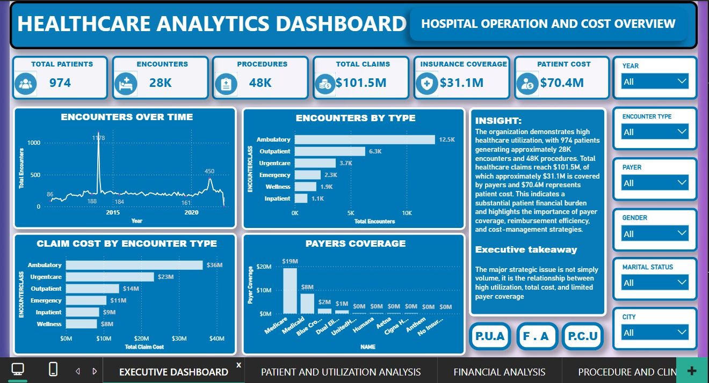
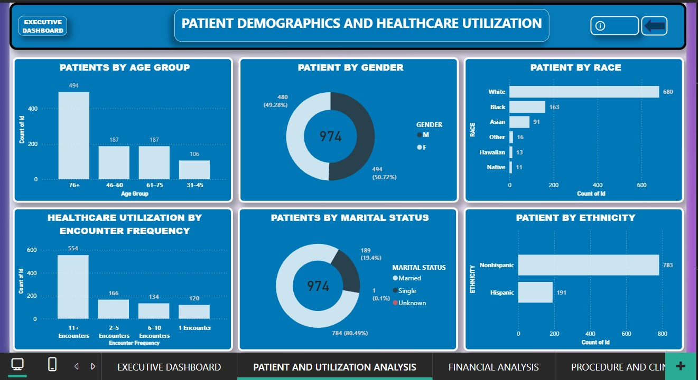
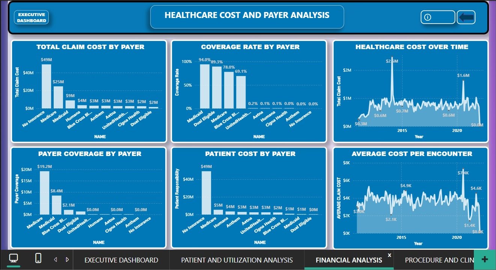
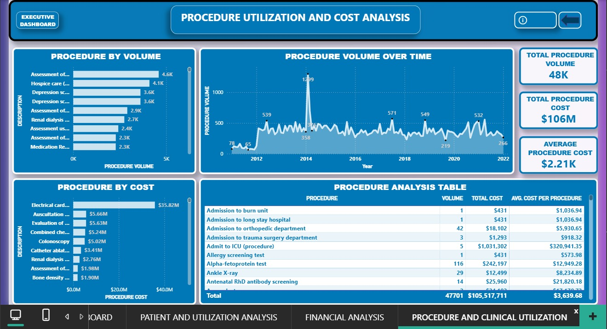
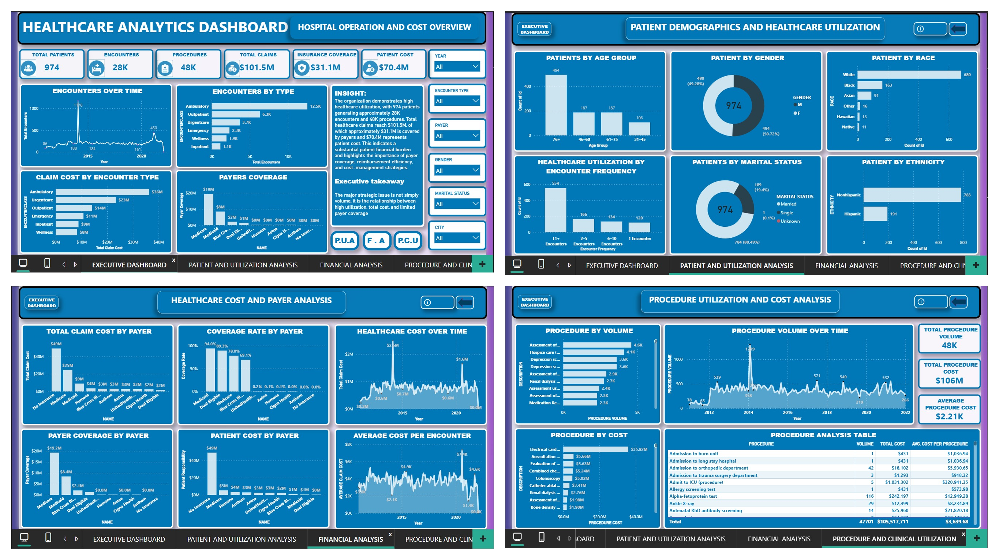

# Healthcare-Analytics-Dashboard-Power-BI
📊 Healthcare Analytics Dashboard | Power BI  I built an interactive Healthcare Analytics Dashboard in Power BI to analyze patient volume, encounter activity, procedure utilization, and healthcare costs.

# Healthcare Analytics Dashboard

**Tools:** Power BI | DAX | Data Modeling | Data Analysis | Data Visualization

## Project Overview
An interactive Power BI dashboard that analyzes patient volume, encounter activity, procedure utilization, and healthcare costs. It helps a healthcare organization understand where activity and financial exposure are concentrated, and where it can optimize.

## Project Demo
🎥 [Watch the dashboard walkthrough on LinkedIn](https://www.linkedin.com/posts/udokanma-anthony-nyenke-99864b412_powerbi-dataanalytics-dataanalyst-activity-7513253893737455616-HRlc)

## Dashboard Preview

### Page 1

### Page 2

### Page 3

### Page 4

### Page 5

## Dataset at a Glance
- **974** patients
- **~28K** encounters
- **~48K** procedures
- **~$101.5M** total claims
- **~$106M** procedure cost

## Analysis Covered
- Patient demographics and encounter patterns
- Encounter utilization by care type
- Procedure volume and procedure cost
- Average claim cost
- Payer mix and financial exposure
- High-volume and high-cost procedures
- Repeat patient encounters and utilization patterns

## Key Questions Answered

**1. How much healthcare activity is being generated?**
974 patients account for approximately 28K encounters and 48K procedures.

**2. Where is utilization concentrated?**
Encounter activity is concentrated mainly in ambulatory care and recurring patient encounters.

**3. Where is financial exposure concentrated?**
Total claims are about $101.5M, with patient responsibility (patient cost) contributing significantly to the overall exposure.

**4. What contributes to financial risk?**
Payer distribution, particularly uninsured or no-insurance encounters, is an important area to monitor.

**5. Where are the optimization opportunities?**
High-volume procedures, high-cost procedures, repeat utilization, and payer coverage offer the main areas for further analysis.

## Interactive Features
- Navigation across multiple dashboard pages
- Information (ⓘ) button that reveals page-specific insights
- Close/arrow button that hides the insight panel and returns the dashboard to its normal view
- Interactive visuals for exploring the data

## Portfolio-Level Insight
The organization serves many patients, with a high number of visits and procedures and significant healthcare costs. Patients' insurance or payment coverage also affects the organization's finances, and patients with repeated visits may have ongoing healthcare needs. These findings can help the organization control costs, monitor patient visits, improve payment coverage, and plan healthcare services.

## Skills Demonstrated
Data modeling, DAX measures, interactive dashboard design, healthcare data analysis, payer and cost analysis, and turning data into business decisions.

## Author
**Udokanma Anthony Nyenke**
Aspiring Data Analyst | Excel, Power BI, SQL, Python, Tableau
GitHub: [UdokanmaNyenke](https://github.com/UdokanmaNyenke)
